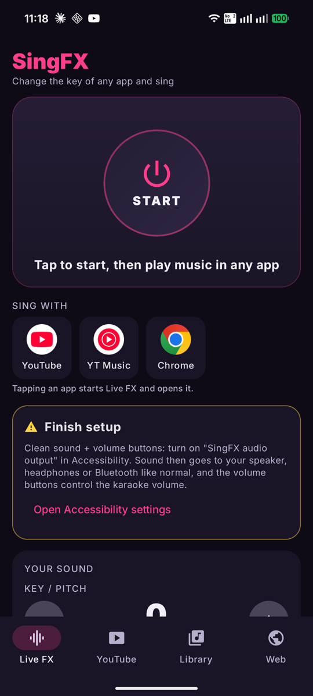
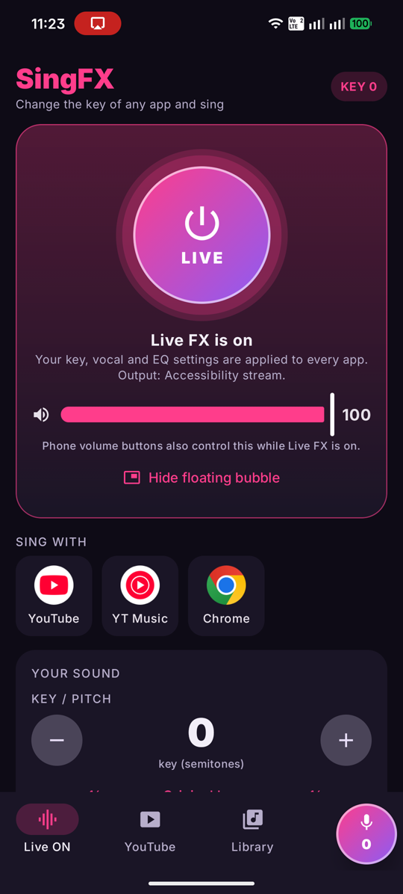
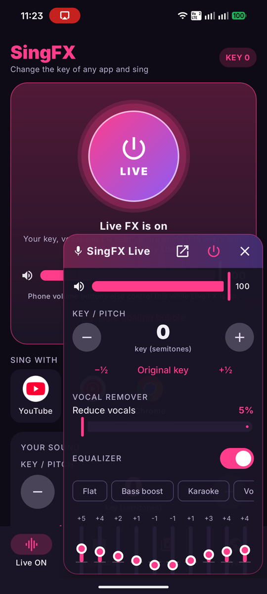

# SingFX: karaoke key changer for Android

Change the key of **YouTube or any app on your phone**, remove vocals and tune the EQ, then sing in your own range.

**[⬇ Download the latest APK](https://github.com/WinThiha/singfx/releases/latest/download/SingFX.apk)** · [Website](https://winthiha.github.io/singfx/) · [Privacy policy](https://winthiha.github.io/singfx/privacy.html)

<p>
  
  
  
</p>

## Features
- **Live FX (home screen):** applies key change, vocal remover and EQ to audio from other apps (YouTube, YouTube Music, Chrome…). One tap on "Sing with YouTube" starts it and opens the app.
- **Floating bubble:** quick controls on top of any app. It stays on screen and snaps to the nearest edge.
- **Volume buttons:** while Live FX runs, they control the karaoke volume and the original sound stays muted.
- **Key / pitch:** ±12 semitones in ½ steps, without changing speed.
- **Vocal remover:** center-channel cancellation that keeps the bass.
- **10-band EQ:** presets (Karaoke, Bass boost, Vocal boost…), output boost with a limiter, and balance.
- **Built-in player:** local music and videos, YouTube search (via [NewPipe Extractor](https://github.com/TeamNewPipe/NewPipeExtractor)), a web browser, and direct media links. Includes speed control and an A–B loop.
- **Updates itself:** checks GitHub Releases for new versions.

## Install
1. Download [`SingFX.apk`](https://github.com/WinThiha/singfx/releases/latest/download/SingFX.apk) on your Android phone (Android 10+).
2. Open it and allow "install unknown apps" if asked. If Play Protect warns about an unrecognized app, choose **Install anyway**.
3. In SingFX, finish the setup card: allow the floating bubble, and turn on **Accessibility → SingFX audio output**. That setting gives SingFX its own audio channel and lets it use the volume buttons; it never reads your screen.
   - If the switch is greyed out ("Restricted setting"), open **Settings → Apps → SingFX → ⋮ → Allow restricted settings** first. Android does this for apps installed from a download.

## How Live FX works
Android's [playback capture API](https://developer.android.com/media/platform/av-capture) delivers other apps' audio to SingFX. SingFX mutes the original media stream, runs the audio through the effects (Sonic pitch shift → vocal remover → biquad EQ → limiter), and plays the result on its own stream. With the accessibility service on, it uses the accessibility stream, which routes like normal media to the speaker, headphones or Bluetooth. Without it, SingFX falls back to the alarm stream. If the app is killed while Live FX is on, the next launch restores the media volume.

Limits: apps that opt out of capture (Netflix, some music apps) can't be processed, and Live mode adds about 0.1–0.2 s of latency.

## Build
Requires JDK 17+ and the Android SDK (compileSdk 36).
```
./gradlew assembleDebug                       # debug build
./gradlew assembleRelease                     # release build, signed if keystore.properties exists
```
Release signing reads `keystore.properties` (git-ignored) with `storeFile`, `storePassword`, `keyAlias` and `keyPassword`. Without it, release builds use the debug key.

### Code map
| Folder | What's in it |
|---|---|
| `dsp/` | `FxState` (persisted settings), `DspChain` (vocal remover, biquad EQ, gain, limiter) |
| `player/` | ExoPlayer setup, `FxAudioProcessor`, background `PlaybackService` |
| `live/` | `LiveFxService` (capture → pitch → DSP → output), floating `OverlayController`, `VolumeA11yService`, quick-settings tile |
| `yt/` | NewPipe Extractor wiring, chunked googlevideo data source |
| `ui/` | Jetpack Compose screens |

## License
[GPL-3.0](LICENSE). SingFX uses NewPipe Extractor, which is GPL-3.0.
